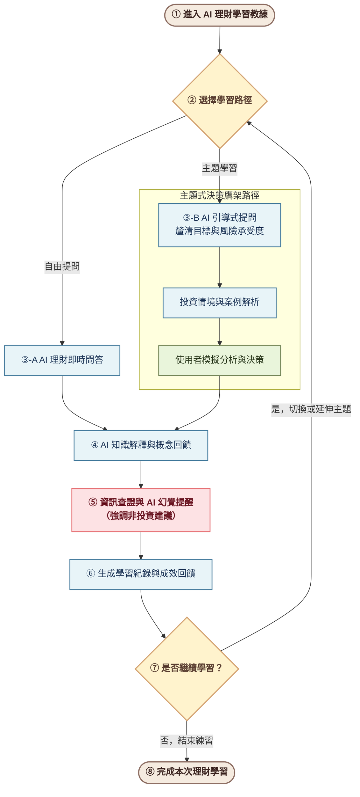
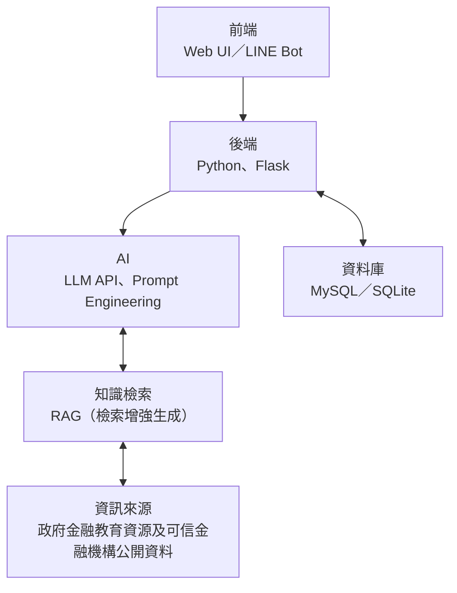

# super-stock

# AI理財學習教練

> **介紹**：協助理財新手學習投資理財的 AI 助教，透過引導式提問釐清觀念、以案例教學練習判斷，並以幻覺提醒標示 AI 可能出錯之處，培養使用者查證資訊、不盲信 AI 的習慣。

> **目標使用者**:
- 18-35歲的年輕族群
- 對個人理財及投資缺乏基本認識，希望從基礎觀念開始學習
- 想了解股票、ETF、基金等投資工具，以及基本風險概念
- 缺乏財務決策經驗，希望學習如何分析情境、評估風險

---

## 1. 背景與動機

- 青年與初入社會者普遍缺乏理財素養，容易在預算、儲蓄、信用與投資上做出不佳決策。
- 傳統理財課程偏重知識講授，缺少個人化回饋與情境練習，學習後不易落實到生活。
- 新手難以分辨 AI 回答是否正確，容易被幻覺誤導。
- 生成式 AI 可引導提問並即時回饋，適合擔任理財學習教練。

## 2. 專題目標

- 協助理財新手理解基礎金融與投資理財知識。
- 透過引導式提問，培養自主思考與財務判斷能力。
- 運用生活化案例，提升金融知識的理解與應用能力。
- 建立 AI 資訊查證與幻覺提醒機制，提升使用者對 AI 理財資訊的辨識能力。
- 
## 3. 核心功能
- AI 引導式學習： 透過循序漸進的提問，引導使用者理解金融概念，而非直接提供答案。
- 投資案例教學： 提供股票、ETF、基金、定期定額等情境案例，讓使用者練習分析與判斷。
- AI 理財知識問答： 使用者可自由詢問投資理財問題，AI 依照使用者程度提供解釋。
- AI 幻覺與風險提醒： 對不確定、缺乏來源或可能過時的資訊進行標示，提醒使用者查證，並區分一般知識與投資建議。
- 學習紀錄與能力回饋： 記錄學習歷程、案例作答及常見觀念錯誤，提供個人化學習建議。

## 4. 系統流程

## 5. 系統模組

- 使用者互動模組：提供對話介面、學習主題選擇及案例操作。
- AI 對話教練模組：運用大型語言模型進行自然語言理解、提問及個人化教學。
- 案例學習模組：管理投資情境、案例題目與學習回饋。
- 資訊查證模組：結合可信資料來源、知識檢索及不確定性提示，降低錯誤資訊造成的誤導。
- 學習管理模組：儲存學習紀錄、作答結果及學習進度。

## 6. 技術架構



| 架構層 | 使用技術 | 說明 |
| --- | --- | --- |
| 前端 | HTML、CSS、JavaScript（原生） | 建立理財學習介面，支援電腦與平板操作 |
| 後端 | Vercel Functions | 處理前端請求、串接 AI API，保護 API 金鑰 |
| AI | Google Gemini API | 提供 AI 理財問答、引導式提問、案例教學與學習回饋 |
| 知識檢索 | RAG（檢索增強生成） | 從可信賴的金融教育資料中檢索資訊，輔助 AI 回答並提供參考來源 |
| 資料庫 | Supabase / SQLite | 儲存使用者學習紀錄、案例作答與學習進度 |
| 部署 | Vercel（連結 GitHub 儲存庫） | 推送程式碼後自動部署，更新網站 |

## 7. 預期成效

- 提升使用者對個人收支及消費習慣的掌握程度。
- 協助使用者建立預算管理與儲蓄規劃能力。
- 透過 AI 互動引導，提升理財知識與財務決策能力。
- 建立結合 AI 技術與個人化學習的理財輔助系統。

## 8. 組員分工

| 組員 | 主要工作 |
| --- |--- |
| 莊維仁 |  | 
| 郭雅芳 |  | 
| 李科翰 |  | 
| 許安杰 |  |

## 資料夾結構
```
isofuckungtired/
└── README.md 
```
