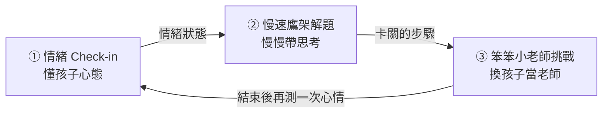
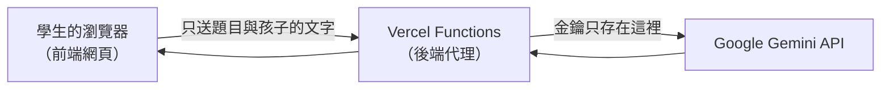

# super-stock

AI理財學習教練

> **介紹**：協助理財新手學習投資理財的 AI 助教，透過引導式提問釐清觀念、以案例教學練習判斷，並以幻覺提醒標示 AI 可能出錯之處，培養使用者查證資訊、不盲信 AI 的習慣。

---

## 1. 背景與動機

- 青年與初入社會者普遍缺乏理財素養，容易在預算、儲蓄、信用與投資上做出不佳決策。
- 傳統理財課程偏重知識講授，缺少個人化回饋與情境練習，學習後不易落實到生活。
- 新手難以分辨 AI 回答是否正確，容易被幻覺誤導。
- 生成式 AI 可引導提問並即時回饋，適合擔任理財學習教練。

## 2. 專題目標

- 依程度與目標提供個人化學習路徑。


2. **培養獨立思考**：AI 不直接給答案，而是一步一步提問，陪孩子拆解題意。
3. **建立自信**：讓孩子糾正機器人的錯誤，體驗「我會，而且我能教別人」。

## 3. 系統流程：三部曲學習閉環



三個模組之間會**互相傳遞資料**，不是各做各的：

| 連接 | 傳遞什麼 | 怎麼用 |
| --- | --- | --- |
| ① → ② | 孩子當下的情緒 | 情緒越低落，提示放得越慢、越多，並先從簡單題開始 |
| ② → ③ | 孩子在哪一步卡關 | 笨笨機器人就故意犯那一類錯誤，等於針對剛學會的地方複習 |
| ③ → ① | 結束時的心情 | 跟一開始的心情比較，當作成效數據 |

## 4. 模組說明

### ① 情緒 Check-in（負責：余玟靜）

- **功能**：學生打開作業時，先用表情圖卡或情境選擇說出心情（例如挫折、想哭、生氣），系統給予正向安撫與調適建議（例如深呼吸、把題目切小塊）。
- **設計重點**：先降低防衛心，再進入解題。
- **理論依據**：社會情緒學習（SEL，CASEL 架構）、數學焦慮。

### ② 慢速鷹架解題（負責：呂佳蓁）

- **功能**：AI 扮演「慢速夥伴」，一次只給一個引導問題或關鍵字，陪孩子拆解題意。
- **設計重點**：
  - 拒絕直接給答案。
  - 孩子連續卡關時，提供「示範一步」的出口，避免挫折感累積。
- **理論依據**：Vygotsky 近側發展區（ZPD）、鷹架理論、蘇格拉底式提問。

### ③ 笨笨小老師挑戰（負責：張祐誠）

- **功能**：孩子算完後，「笨笨機器人」跳出來，故意犯一個常見的迷思錯誤（例如進位忘記加）。孩子要指出錯誤，並用文字或語音教會它。
- **設計重點**：
  - 孩子**先自己答對**，機器人才出場，避免弱勢學生被錯誤答案混淆。
  - 錯誤答案由程式依迷思類型產生，對錯也由程式判斷；AI 只負責讓機器人用「笨笨的口吻」對話與回應。
  - 孩子找不到錯誤時，機器人會給提示，不讓孩子再受一次挫折。
- **理論依據**：以教促學（learning by teaching）、可教代理人（teachable agent）、錯例學習（erroneous examples）。

## 5. 實作範圍

| 項目 | 第一版（期末完成） | 未來擴充 |
| --- | --- | --- |
| 年級與單元 | 暫定：三年級「三位數加減直式（進退位）」 | 擴充到其他年級與單元 |
| 情緒偵測 | 表情圖卡／情境選擇 | 語音情緒偵測 |
| 小老師糾正 | 點選錯誤位置＋文字說明 | 語音說明（瀏覽器內建 Web Speech API） |
| 答案判斷 | 程式計算（不交給 AI） | — |

> 為什麼先不做語音情緒偵測？準確度不穩定，而且會蒐集兒童聲音，個資風險較高。

## 6. 技術架構



| 層級 | 使用技術 | 說明 |
| --- | --- | --- |
| 前端 | HTML、CSS、JavaScript（原生） | 不使用大型框架，平板與電腦都能開 |
| 後端 | Vercel Functions | 代替前端呼叫 AI，保護金鑰 |
| AI | Google Gemini API | 產生慢速提示與笨笨機器人的對話 |
| 部署 | Vercel（連結本 GitHub 儲存庫） | 推送程式後自動更新網站 |

**金鑰安全**

- 本儲存庫是公開的，**Gemini 金鑰不可寫在程式碼或前端網頁裡**。
- 金鑰設定在 Vercel 後台的環境變數 `GEMINI_API_KEY`；本機測試時放在 `.env`（已列入 `.gitignore`）。
- 在 Google AI Studio 設定用量上限，避免網址被濫用導致額度耗盡。

## 7. 預期成效與評估方式（暫定）

| 研究問題 | 評估方式 |
| --- | --- |
| RQ1：使用系統後，學生的數學焦慮是否下降？ | 使用前後的心情 Check-in 紀錄、數學焦慮量表 |
| RQ2：學生的單元解題正確率是否提升？ | 前後測 |
| RQ3：學生「我做得到」的自信是否提升？ | 數學自我效能問卷、小老師挑戰的成功率 |

## 8. 個資與資料保護

- 學生一律使用**代號**（班級代號＋座號，例如 30105），不蒐集姓名。
- 只蒐集達成研究目的的最少資料：代號、心情選項、作答紀錄。
- 情緒資料屬於敏感資料，**活動結束後即刪除**。
- 使用 Google Gemini 屬於資料委外處理；到班試用前，會先向學校資安窗口報備，並取得家長同意。

## 9. 時程規劃（暫定，依課程期限調整）

| 階段 | 工作內容 |
| --- | --- |
| 第 1–2 週 | 確定年級單元、整理迷思錯誤清單、設計畫面草圖 |
| 第 3–5 週 | 三個模組分頭開發，並約定模組之間的資料格式 |
| 第 6–7 週 | 串接三部曲流程、串接 Gemini API |
| 第 8 週 | 小規模試用與修正 |
| 第 9 週 | 整理成果、期末報告 |

## 10. 組員分工

| 組員 | 負責模組 | 主要工作 |
| --- | --- | --- |
| 余玟靜 | ① 情緒 Check-in | 情緒選項設計、安撫話術、前後心情比較 |
| 呂佳蓁 | ② 慢速鷹架解題 | 引導提問設計、提示分級、卡關判斷 |
| 張祐誠 | ③ 笨笨小老師挑戰 | 迷思錯誤設計、笨笨機器人對話、Gemini 串接 |
| 待定 | 系統整合 | 三個模組的資料串接、部署 |

## 11. 參考文獻（引用前請再核對原文）

> 近五年 SSCI 論文與相關專利（不限年份）整理，請見 [docs/文獻與專利.md](docs/文獻與專利.md)。

**經典理論文獻**

- Adams, D. M., et al. (2014). Using erroneous examples to improve mathematics learning with a web-based tutoring system. *Computers in Human Behavior, 36*, 401–411.
- Ashcraft, M. H. (2002). Math anxiety: Personal, educational, and cognitive consequences. *Current Directions in Psychological Science, 11*(5), 181–185.
- Biswas, G., Leelawong, K., Schwartz, D., Vye, N., & TAG-V. (2005). Learning by teaching: A new agent paradigm for educational software. *Applied Artificial Intelligence, 19*(3–4), 363–392.
- CASEL. *What is the CASEL framework?* https://casel.org/
- Chase, C. C., Chin, D. B., Oppezzo, M. A., & Schwartz, D. L. (2009). Teachable agents and the protégé effect: Increasing the effort towards learning. *Journal of Science Education and Technology, 18*(4), 334–352.
- Vygotsky, L. S. (1978). *Mind in society: The development of higher psychological processes*. Harvard University Press.
- Wood, D., Bruner, J. S., & Ross, G. (1976). The role of tutoring in problem solving. *Journal of Child Psychology and Psychiatry, 17*(2), 89–100.

---

## 資料夾結構

```
team-work/
├── docs/           文件、會議紀錄、簡報摘要、文獻與專利整理
├── .env.example    環境變數範本（複製成 .env 後自行填寫）
├── .gitignore      不上傳到 GitHub 的檔案清單
└── README.md       專題計畫書（就是這份）
```

## 協作規則

- 動手前先 `git pull`，取得組員最新的修改。
- 提交前先 `git status`，確認沒有 `.env` 或金鑰檔。
- commit 訊息用中文簡短寫清楚「改了什麼」，例如：`新增情緒 Check-in 畫面`。
- 本儲存庫為公開（Public），**不可放入金鑰、密碼或學生個資**。
